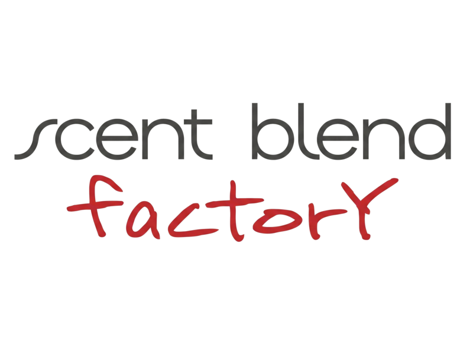

  

# Scent Blend knowledgebase

Start with the [company identity](company/identity.md).

| Area | What belongs here |
| --- | --- |
| [Company](company/README.md) | Identity, discovery, meetings, workshops, decisions and direction |
| [Finance](finance/README.md) | Financial workflow, assumptions and reporting |
| [Systems](systems/) | Tool access and configuration, e.g. [CRM](systems/crm.md) |

## Common tasks

- [CRM access and data model](systems/crm.md)
- [Process bank exports and rebuild reports](finance/README.md#processing-new-exports)
- [Check stock on hand](data/inventory/README.md#stock-on-hand)
- [Read meeting notes](company/meetings/)

## Adding knowledge

Keep procedures with their business area. Give each SOP an owner, trigger, steps, expected result, exceptions and last-reviewed date. Link across areas rather than duplicating instructions. Add a new top-level area or subfolder only when there is content to put in it.

Keep actual customer and order records in the CRM. Keep signed agreements in Google Drive when connected, with people agreement links under `team/` and customer agreement links under `customers/` (create each folder with its first link). Access to source documents is managed in their source system.

Operational inputs remain in `data/`, generated outputs in `reports/`, and automation in [scripts/](scripts/README.md). Private financial inputs and reports are excluded from Git and may only be available in the working copy.
