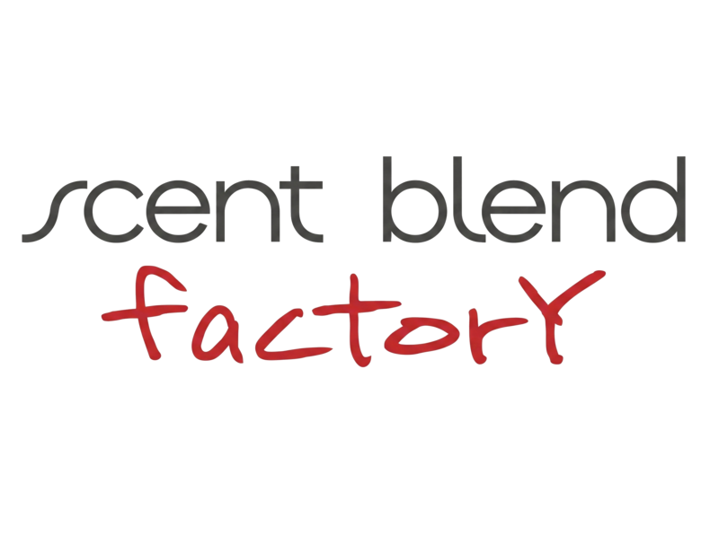

  

# Scent Blend knowledgebase

Start with the [company identity](company/identity.md).

| Area | What belongs here |
| --- | --- |
| [Company](company/README.md) | Identity, discovery, meetings, decisions and direction |
| [Team](team/README.md) | People, roles, responsibilities, onboarding and people agreements |
| [Customers](customers/README.md) | Customer card, segmentation and sales and service procedures |
| [Products](products/README.md) | Catalog, specifications and pricing |
| [Production](production/README.md) | Recipes, manufacturing and quality procedures |
| [Inventory](inventory/README.md) | Suppliers, materials and stock-handling procedures |
| [Finance](finance/README.md) | Financial workflow, assumptions and reporting |
| [Systems](systems/README.md) | Tool access, navigation and configuration |

## Common tasks

- [CRM access and documentation](systems/crm/README.md)
- [Customer card specification](customers/customer-card.md)
- [Process bank exports and rebuild reports](finance/README.md#processing-new-exports)
- [Check stock on hand](data/inventory/README.md#stock-on-hand)
- [Read meeting notes](company/meetings/)

## Adding knowledge

Keep procedures with their business area. Give each SOP an owner, trigger, steps, expected result, exceptions and last-reviewed date. Link across areas rather than duplicating instructions. Add subfolders when there is content to organize.

Keep actual customer and order records in the CRM. Keep signed agreements in Google Drive when connected, with people agreement links under `team/` and customer agreement links under `customers/`. Access to source documents is managed in their source system.

Operational inputs remain in `data/`, generated outputs in `reports/`, and automation in [scripts/](scripts/README.md). Private financial inputs and reports are excluded from Git and may only be available in the working copy.
