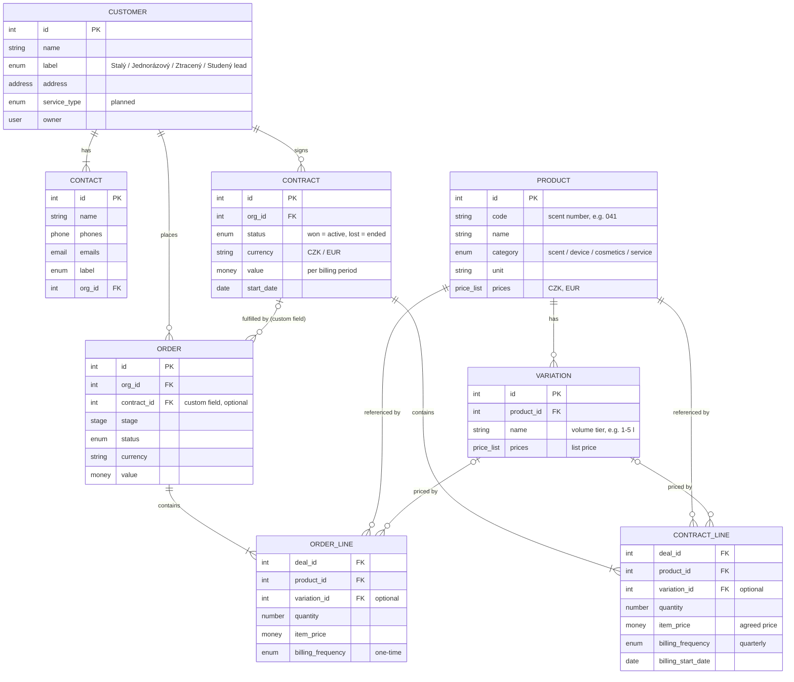

# CRM

Status: approved 2026-11-03; not yet applied in Pipedrive. Interim: products stay as text until the catalogue exists (see below). Current-state facts were read from the workspace on 2026-11-03.

Pipedrive is the company CRM ([October 30 meeting analysis](../company/meetings/2026-10-30-apartment-letna-i-ii-analysis.md)). This page holds access details, the data model and its current state. Actual customer and order records live in Pipedrive, not here.

## Access

| Access detail | Status |
| --- | --- |
| Company workspace URL | To confirm |
| Access owner | To confirm |
| How to request access | To confirm |

Credentials belong in the company's credential manager.

## Data model

Business entities and how they map to Pipedrive objects.

## Diagram

Visual version: [Figma — ScentBlend customer data model](https://www.figma.com/design/t3LJXRyEnzbUngAkCIVJQQ/ScentBlend?node-id=3-2).

## Pipedrive objects

Objects available in the workspace. "Connector" means the Pipedrive MCP connector exposes tools for it (checked 2026-11-03). Other rows come from Pipedrive product knowledge and need a check in the workspace.

| Object | What it is | Ground |
| --- | --- | --- |
| Organization | Company | Connector |
| Person | Contact; belongs to at most one organization | Connector |
| Lead | Unqualified opportunity in the Leads Inbox, outside pipelines | Connector |
| Deal | Opportunity moving through a pipeline | Connector |
| Pipeline, stage | Deal flow definitions | Connector |
| Product, product variation | Catalog entry and its priced options | Connector |
| Deal product | Product line on a deal: quantity, price, billing frequency | Connector |
| Activity | Call, meeting, task or deadline with a due date | Connector |
| Note | Text attached to a deal, person, organization or lead | Connector |
| Mail thread, mail message | Synced email | Connector |
| Project, board, phase, task | Delivery work after a deal; paid add-on | Connector; add-on status not checked |
| User | Team member | Connector |
| Label, custom field | Metadata on the objects above | Connector |
| Filter, goal, automation, file | Saved views, targets, workflows, attachments | Product knowledge |

Pipedrive has no custom objects as far as we know; only custom fields on existing objects. Not yet confirmed against current Pipedrive documentation.

## Mapping to Pipedrive

| Entity | Pipedrive object | Distinguished by |
| --- | --- | --- |
| Customer | Organization | — |
| Contact | Person | — |
| Contract | Deal | Pipeline `Smlouvy` |
| Order | Deal | Pipeline `Objednávky` |
| ContractLine | Deal product | Deal in `Smlouvy`; `billing_frequency` = `quarterly` |
| OrderLine | Deal product | Deal in `Objednávky`; `billing_frequency` = `one-time` |
| Product | Product | — |
| Variation | Product variation | — |
| Catalog | — | The product list itself, not an object |

Not used by the model: Lead (could hold unqualified first contacts before a sales deal), Project (could group a contract with its orders if the add-on is enabled).

Contract to Order has no native link. Custom fields can reference an organization, person or user but, as far as we know, not a deal, so `contract_id` is a numeric field without validation.

## Entities

| Entity | Pipedrive object | Definition | Created when |
| --- | --- | --- | --- |
| Customer | Organization | The paying company or person | First contact |
| Contact | Person | A person we talk to at the customer | First contact |
| Contract | Deal, pipeline `Smlouvy` | Standing agreement for recurring supply | Sale won with recurring terms |
| Order | Deal, pipeline `Objednávky` | One delivery: one-off sale or one period of a contract | Sale won one-off, or each contract period |
| ContractLine | Deal product on a contract deal | Agreed product, volume, price and frequency | With the contract |
| OrderLine | Deal product on an order deal | Delivered product, quantity and price | With the order |
| Product | Product | One catalog entry | Catalog maintenance |
| Variation | Product variation | Volume tier of a product with its own list price | Catalog maintenance |

## Relationships

| From | To | Cardinality | Native in Pipedrive |
| --- | --- | --- | --- |
| Customer | Contact | 1 to 1..n | Yes, `org_id` on Person |
| Customer | Contract | 1 to 0..n | Yes, `org_id` on Deal |
| Customer | Order | 1 to 0..n | Yes, `org_id` on Deal |
| Contract | Order | 0..1 to 0..n | No, needs a custom field on the order deal |
| Contract / Order | Line | 1 to 1..n | Yes, deal products |
| Product | Line | 1 to 0..n | Yes, `product_id` |
| Product | Variation | 1 to 0..n | Yes |
| Variation | Line | 0..1 to 0..n | Yes, `product_variation_id` |

## Rules

- A one-off customer has orders and no contract.
- List price lives on the variation. The agreed customer price lives on the contract line.
- Recurrence is `billing_frequency` on contract lines. Order lines are always `one-time`.
- Ending a contract means marking its deal lost. The customer label changes to Ztracený zákazník.

## Purposes the model must serve

| Need | Source |
| --- | --- |
| Issue invoices on time | Contract line `billing_start_date` + `billing_frequency` |
| Plan inventory and material | Sum of contract line `quantity` per product per period |
| Financial plan 1–2 years ahead | Pipedrive revenue forecast over recurring contract lines |

## Current state (2026-11-03)

Working customer profiles in `data/enriched/customer-notes.md` and registry data in `data/enriched/customer-registry.csv` are private supporting material. Check their claims against source records.

- One pipeline mixes sales and fulfillment stages; one deal equals one order.
- Organization holds the service profile as seven free-text custom fields, filled on few records.
- Products are ad hoc per deal, with price 0, no code and no category.
- `website`, `linkedin`, `industry`, `annual_revenue` and `employee_count` are unused.

| Organization custom field | Key |
| --- | --- |
| Typ služby | `45818478d3ffb7ecf07e647709aabce982d62f07` |
| Produkty | `6adb193828d85f10a37c2f592f90679b2d73388f` |
| Vůně | `a67cae6580c8f5c768b95fd9da5f72dbc62db650` |
| Objem odebrané vůně | `ee2bdd3e6766b21acdd62bb2af520cddc4aebbb9` |
| Cena nabízených produktů | `369a88f6605ceaa0a971fc4c1ba00bada418a04e` |
| Cena vybrané vůně v závislosti na odebraném objemu | `bc80f1e79295eeefe02569202d2ef4309e86f535` |
| Frekvence odběru | `9b6d60c664e321746e5e41709adce37027d5024a` |

These fields are replaced by contract lines once the model is applied.

## Interim: products as text

Decided 2026-11-03. Until the product catalogue exists, a contract deal has no product lines, because a Pipedrive deal product must reference a catalog product. The contract deal carries its terms as custom fields instead:

| Contract field | Type | Purpose |
| --- | --- | --- |
| products | text | Devices, scents and volumes as agreed |
| volume | text | Agreed scent volume per period |
| frequency | single option | Monthly / quarterly / yearly |
| price_per_period | monetary | Basis for invoicing and forecast |
| next_billing_date | date | Invoice reminder |

Order deals may still use product lines once products exist. Converting contract text to product lines is roadmap task 9 in [company/roadmap.md](../company/roadmap.md).

## Open decisions

- Create pipelines `Smlouvy` and `Objednávky`, or keep one pipeline.
- Allowed values for `service_type` and product `category`.
- Who creates each period's order deal: a person, a Pipedrive automation or a script.
- Reporting currency for mixed CZK and EUR contracts.
- Customer card: required fields, allowed values and owners for legal entity identification, contacts, sites, responsible person and next action. Discussed at the [October 30 meeting](../company/meetings/2026-10-30-apartment-letna-i-ii-analysis.md): customer type (recurring, one-off, lost), activity, industry, products and services, payment frequency, upsell opportunities.
- Navigation guide: document finding and updating a customer and progressing an order after a walkthrough of the workspace.
