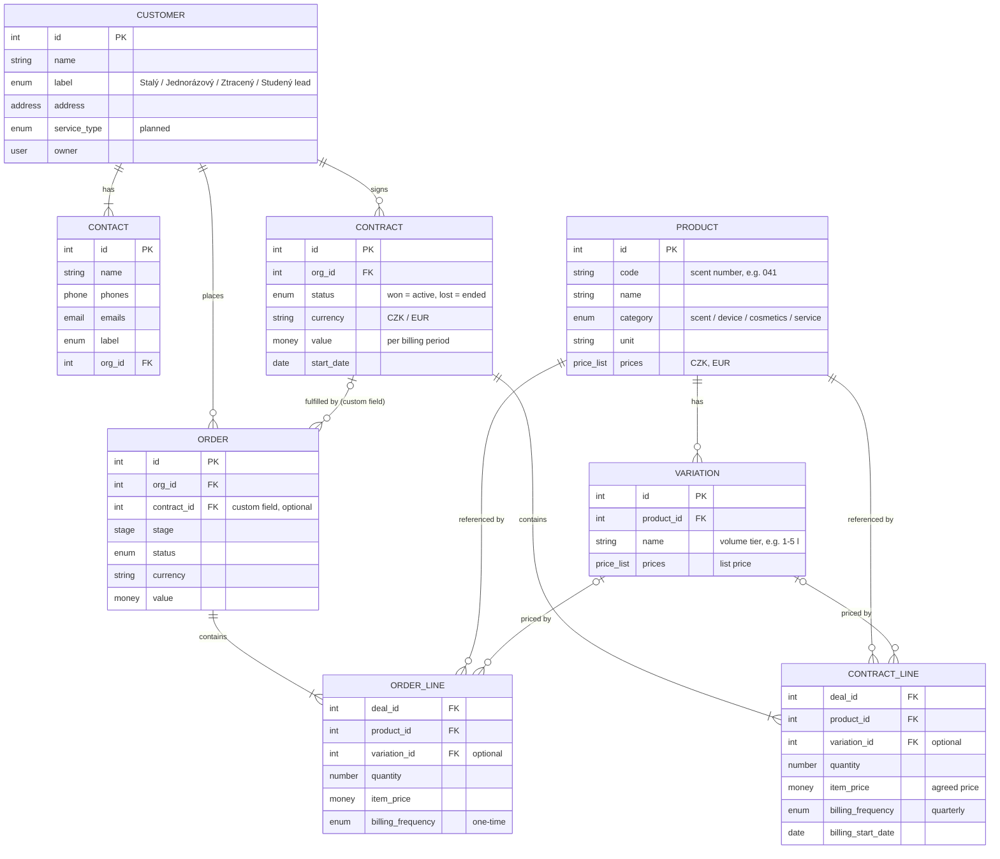

# CRM

Status: approved 2026-11-03; not yet applied in Pipedrive. Interim: products stay as text until the catalogue exists (see below). Current-state facts were read from the workspace on 2026-11-03.

Pipedrive is the company CRM ([October 30 meeting analysis](../company/meetings/2026-10-30-apartment-letna-i-ii-analysis.md)). This page holds access details, the data model and its current state. Actual customer and order records live in Pipedrive, not here.

## Access

| Access detail | Status |
| --- | --- |
| Company workspace URL | To confirm |
| Access owner | To confirm |
| How to request access | To confirm |

Credentials belong in the company's credential manager.

## Data model

Business entities and how they map to Pipedrive objects.

## Diagram

Visual version: [Figma — ScentBlend customer data model](https://www.figma.com/design/t3LJXRyEnzbUngAkCIVJQQ/ScentBlend?node-id=3-2).

## Pipedrive objects

Objects available in the workspace. "Connector" means the Pipedrive MCP connector exposes tools for it (checked 2026-11-03). Other rows come from Pipedrive product knowledge and need a check in the workspace.

| Object | What it is | Ground |
| --- | --- | --- |
| Organization | Company | Connector |
| Person | Contact; belongs to at most one organization | Connector |
| Lead | Unqualified opportunity in the Leads Inbox, outside pipelines | Connector |
| Deal | Opportunity moving through a pipeline | Connector |
| Pipeline, stage | Deal flow definitions | Connector |
| Product, product variation | Catalog entry and its priced options | Connector |
| Deal product | Product line on a deal: quantity, price, billing frequency | Connector |
| Activity | Call, meeting, task or deadline with a due date | Connector |
| Note | Text attached to a deal, person, organization or lead | Connector |
| Mail thread, mail message | Synced email | Connector |
| Project, board, phase, task | Delivery work after a deal; paid add-on | Connector; add-on status not checked |
| User | Team member | Connector |
| Label, custom field | Metadata on the objects above | Connector |
| Filter, goal, automation, file | Saved views, targets, workflows, attachments | Product knowledge |

Pipedrive has no custom objects as far as we know; only custom fields on existing objects. Not yet confirmed against current Pipedrive documentation.

## Mapping to Pipedrive

| Entity | Pipedrive object | Distinguished by |
| --- | --- | --- |
| Customer | Organization | — |
| Contact | Person | — |
| Contract | Deal | Pipeline `Smlouvy` |
| Order | Deal | Pipeline `Objednávky` |
| ContractLine | Deal product | Deal in `Smlouvy`; `billing_frequency` = `quarterly` |
| OrderLine | Deal product | Deal in `Objednávky`; `billing_frequency` = `one-time` |
| Product | Product | — |
| Variation | Product variation | — |
| Catalog | — | The product list itself, not an object |

Not used by the model: Lead (could hold unqualified first contacts before a sales deal), Project (could group a contract with its orders if the add-on is enabled).

Contract to Order has no native link. Custom fields can reference an organization, person or user but, as far as we know, not a deal, so `contract_id` is a numeric field without validation.

## Entities

| Entity | Pipedrive object | Definition | Created when |
| --- | --- | --- | --- |
| Customer | Organization | The paying company or person | First contact |
| Contact | Person | A person we talk to at the customer | First contact |
| Contract | Deal, pipeline `Smlouvy` | Standing agreement for recurring supply | Sale won with recurring terms |
| Order | Deal, pipeline `Objednávky` | One delivery: one-off sale or one period of a contract | Sale won one-off, or each contract period |
| ContractLine | Deal product on a contract deal | Agreed product, volume, price and frequency | With the contract |
| OrderLine | Deal product on an order deal | Delivered product, quantity and price | With the order |
| Product | Product | One catalog entry | Catalog maintenance |
| Variation | Product variation | Volume tier of a product with its own list price | Catalog maintenance |

### Activity: next action, not a task

An Activity is the next action with a customer: a dated call, meeting, email, deadline or to-do, owned by one user and linked to a deal, person or organization. It answers "who does what next with this customer, and when". It is not an issue-tracker task: it has only done / not done, no workflow states, subtasks, dependencies or comment thread. "Úkol" is one Activity type among six, not a separate object.

- Proposed, not yet approved: every open deal has one open Activity; a deal without one has no next step.
- Internal work (configuration, catalog, scripts, procedures) is tracked in YouTrack project [SB_CUST](https://scentblend.youtrack.cloud/projects/SB_CUST), not as Activities.
- Pipedrive Project tasks are closer to issue-tracker tasks; their fields are not yet checked and the model does not use them.

## Relationships

| From | To | Cardinality | Native in Pipedrive |
| --- | --- | --- | --- |
| Customer | Contact | 1 to 1..n | Yes, `org_id` on Person |
| Customer | Contract | 1 to 0..n | Yes, `org_id` on Deal |
| Customer | Order | 1 to 0..n | Yes, `org_id` on Deal |
| Contract | Order | 0..1 to 0..n | No, needs a custom field on the order deal |
| Contract / Order | Line | 1 to 1..n | Yes, deal products |
| Product | Line | 1 to 0..n | Yes, `product_id` |
| Product | Variation | 1 to 0..n | Yes |
| Variation | Line | 0..1 to 0..n | Yes, `product_variation_id` |

## Rules

- A one-off customer has orders and no contract.
- List price lives on the variation. The agreed customer price lives on the contract line.
- Recurrence is `billing_frequency` on contract lines. Order lines are always `one-time`.
- Ending a contract means marking its deal lost. The customer label changes to Ztracený zákazník.

## Purposes the model must serve

| Need | Source |
| --- | --- |
| Issue invoices on time | Contract line `billing_start_date` + `billing_frequency` |
| Plan inventory and material | Sum of contract line `quantity` per product per period |
| Financial plan 1–2 years ahead | Pipedrive revenue forecast over recurring contract lines |

## Segmentation

Status: proposal 2026-11-06, not approved; roadmap task 2 in [company/roadmap.md](../company/roadmap.md). Based on the customer card discussion at the [October 30 meeting](../company/meetings/2026-10-30-apartment-letna-i-ii-analysis.md), the [November 1 meeting](../company/meetings/2026-11-01-riders-coffee-analysis.md) and the service lines in [company/identity.md](../company/identity.md).

Principle: each dimension answers one question and serves at least one process. A dimension that no process uses is not added.

### What exists today

| Field | Problem |
| --- | --- |
| Organization labels: Stálý, Jednorázový, Ztracený zákazník, Studený lead | Mixes two dimensions: payment pattern (Stálý / Jednorázový) and lifecycle (Ztracený / Studený lead). Labels are multi-select, so a customer can carry contradictory values. |
| Person labels | Repeat the customer labels; a customer type belongs on the organization. |
| `industry` | 20 generic Pipedrive values, unused; they do not match our segments. |
| Typ služby, Frekvence odběru, Produkty, Vůně, prices | Free text; cannot be filtered or counted. |
| `address` | Gives country and city; enough for the region dimension. |
| Won deals with value | Revenue per customer; derived, needs no field. |

### Dimensions and purposes

| Dimension | Question | Process that uses it | Where it lives |
| --- | --- | --- | --- |
| Service type | What do they buy from us? | Offers, cross-sell, capacity planning | Organization field |
| Payment pattern | Is revenue recurring or one-off? | Financial forecast, invoicing | Frequency on the contract; customer-level value derived from it |
| Status | Are they buying now? | Customer care: touch dormant, win back lost | Organization field |
| Growth potential | How much more could they buy, and why? | Sales focus: who to call first | Organization fields |
| Segment | What kind of business are they? | Marketing, market-share analysis, segment pilots (hotels) | Organization field |
| Acquisition source | Where did they come from? | Marketing return, e.g. the LinkedIn hypothesis | Organization field |
| Region | Where are they? | Logistics, market entry (Germany 2027) | `address`, exists |
| Value tier (A/B/C) | How much do they bring us? | Service level; small clients may cost more to serve than they bring | Derived from won deals; no field |

Payment frequency belongs on the contract, not the customer, because one customer can have several contracts with different frequencies. The forecast reads contracts. The customer only needs recurring or one-off, set by hand until contracts exist in Pipedrive.

### Service types

From the service lines on the website:

1. Space scenting: diffusers and scent in commercial interiors, recurring.
2. Private label: products under the client's brand.
3. Distribution: our products for resale in retail and on marketplaces.
4. Brand experience: events and activations.

A customer can have several service types, e.g. a hotel with scenting and merchandise, so the field is multi-select. The e-shop is a sales channel, not a service: it appears under source and segment. Diffuser rental is still an idea and gets no value.

### Proposed Organization fields

| Field | Type | Values | Replaces |
| --- | --- | --- | --- |
| `segment` | single option | Hotel and resort, Restaurant and café, Wellness and spa, Beauty studio, Showroom and retail, Shopping centre, Office, Brand, Agency and events, Distributor, Private person | `industry` |
| `service_types` | multiple options | Space scenting, Private label, Distribution, Brand experience | Typ služby |
| `status` | single option | Prospect, Active, Dormant, Lost | Lifecycle labels |
| `payment_pattern` | single option | Recurring, One-off | Stálý / Jednorázový labels; Frekvence odběru moves to the contract |
| `potential_value` | monetary, per year | Estimate | — |
| `potential_note` | text | Why, and what to offer | — |
| `source` | single option | LinkedIn, Referral, Personal network, Website, E-shop, Event, Cold outreach | — |

- Dormant: no active contract and no won order for 6 months (two missed quarterly cycles). Proposed threshold. Later a script can set `status` from deal data, so nobody maintains it by hand.
- Potential stays on the organization after a refusal, so the team can return to the offer (October 30 meeting). A concrete upsell offer becomes a deal with an Activity as its next step.
- Retire labels once the new fields exist, so the same fact is not stored twice.

## Current state

Facts below were read from the workspace on 2026-11-03; the field schema was re-read with the connector's `getAccountContext` on 2026-11-06. Fill rates were not re-checked.

Working customer profiles in `data/enriched/customer-notes.md` and registry data in `data/enriched/customer-registry.csv` are private supporting material. Check their claims against source records.

- One pipeline mixes sales and fulfillment stages; one deal equals one order.
- Organization holds the service profile as seven free-text custom fields, filled on few records. They are replaced by contract lines once the model is applied.
- Products are ad hoc per deal, with price 0, no code and no category.
- `website`, `linkedin`, `industry`, `annual_revenue` and `employee_count` are unused.
- Deal and Person have no custom fields. The interim contract fields below do not exist yet.
- There is no IČO or DIČ field on Organization.

### Workspace schema

The tables omit fields every object has: `id`, `add_time`, `update_time`, `visible_to`, `is_deleted`, `smart_bcc_email`, next and last activity, and the activity, email, file, note, follower and deal counters. The connector returns no field schema for Lead, Deal product or Product variation.

#### Organization

| Field | Key | Type | Values / note |
| --- | --- | --- | --- |
| Název | `name` | text | |
| Štítky | `label_ids` | set | Stálý zákazník, Ztracený zákazník, Jednorázový zákazník, Studený lead |
| Vlastník | `owner_id` | user | |
| Adresa | `address` | address | Street, number, city, postal code, country, region |
| Webová stránka | `website` | text | Unused |
| Profil na LinkedInu | `linkedin` | text | Unused |
| Odvětví | `industry` | option | 20 Pipedrive default values; unused |
| Roční příjmy | `annual_revenue` | option | USD bands; unused |
| Počet zaměstnanců | `employee_count` | int | Unused |
| Typ služby | `45818478d3ffb7ecf07e647709aabce982d62f07` | text | Custom |
| Produkty | `6adb193828d85f10a37c2f592f90679b2d73388f` | long text | Custom |
| Vůně | `a67cae6580c8f5c768b95fd9da5f72dbc62db650` | text | Custom |
| Objem odebrané vůně | `ee2bdd3e6766b21acdd62bb2af520cddc4aebbb9` | text | Custom |
| Cena nabízených produktů | `369a88f6605ceaa0a971fc4c1ba00bada418a04e` | text | Custom |
| Cena vybrané vůně v závislosti na odebraném objemu | `bc80f1e79295eeefe02569202d2ef4309e86f535` | text | Custom |
| Frekvence odběru | `9b6d60c664e321746e5e41709adce37027d5024a` | text | Custom |

#### Person

| Field | Key | Type | Values / note |
| --- | --- | --- | --- |
| Název | `name` | text | |
| Jméno / Příjmení | `first_name` / `last_name` | text | |
| Telefon | `phones` | phone | Multiple |
| E-mail | `emails` | text | Multiple |
| Organizace | `org_id` | organization | At most one |
| Štítky | `label_ids` | set | Stálý zákazník, Jednorázový zákazník, Potenciální zákazník, Ztracený zákazník |
| Vlastník | `owner_id` | user | |

#### Deal

| Field | Key | Type | Values / note |
| --- | --- | --- | --- |
| Název | `title` | text | |
| Hodnota | `value` + `currency` | monetary | |
| Organizace | `org_id` | organization | |
| Kontaktní osoba | `person_id` | person | |
| Vlastník | `owner_id` | user | |
| Nástěnka | `pipeline_id` | pipeline | One pipeline: `Pipeline` |
| Fáze | `stage_id` | stage | See stages below |
| Stav | `status` | status | open, won, lost, deleted |
| Pravděpodobnost | `probability` | int | Deal probability is off in the pipeline |
| Štítek | `label_ids` | set | No labels defined |
| Důvod ztráty | `lost_reason` | option | No reasons defined |
| Předpokládaný termín uzavření | `expected_close_date` | date | |
| Čas výhry / ztráty / uzavření | `won_time` / `lost_time` / `close_time` | date | |
| Původ, Zdrojový kanál | `origin`, `channel` | option | Pipedrive defaults |
| Stav archivu, Čas archivace | `is_archived`, `archive_time` | boolean / date | |

Stages of `Pipeline` in display order (stage ID in brackets): První kontakt (1), Zjištění potřeb (2), Příprava nabídky (3), Potvrzení objednávky (5), Vystavení faktury (4), Faktura uhrazena (6), Objednání materiálu (7), Realizace objednávky (8), Objednávka odeslána / předána (9).

#### Product

| Field | Key | Type | Values / note |
| --- | --- | --- | --- |
| Název | `name` | text | |
| Kód produktu | `code` | text | |
| Jednotková | `unit` | text | |
| Daň | `tax` | number | |
| Kategorie | `category` | option | No values defined |
| Popis | `description` | long text | |
| Ceny | `prices` | price list | |
| Linkable | `is_linkable` | boolean | |
| Vlastník | `owner_id` | user | |

#### Activity

| Field | Key | Type | Values / note |
| --- | --- | --- | --- |
| Předmět | `subject` | text | |
| Typ | `type` | option | Hovor, Schůzka, Úkol, Termín, Poslat e-mail, Oběd |
| Dokončeno | `done` | boolean | |
| Termín, Čas termínu, Doba trvání | `due_date`, `due_time`, `duration` | date / time | |
| Deal, Lead, Projekt, Organizace, Kontaktní osoba | `deal_id`, `lead_id`, `project_id`, `org_id`, `person_id` | links | |
| Přiřazeno uživateli | `owner_id` | user | |
| Priorita | `priority` | option | Nízká, Středně velký, Vysoká |
| Výsledek | `outcome` | option | Pipedrive call-outcome defaults |
| Poznámka, Veřejný popis | `note`, `public_description` | long text | |
| Místo | `location` | address | |

#### Project

The schema lists Project fields, which suggests the add-on is enabled; not checked in the workspace.

| Field | Key | Type | Values / note |
| --- | --- | --- | --- |
| Název, Popis | `title`, `description` | text | |
| Datum zahájení / ukončení | `start_date` / `end_date` | date | |
| Štítky | `label_ids` | set | Implementace, Doručení, Interní projekt, Marketing |
| Stav | `status` | status | open, completed, canceled |
| Stav projektu | `health_status` | option | Podle plánu, Rizikový, Mimo plán, Pozastaveno |
| Tabule, Fáze | `board_id`, `phase_id` | links | |
| Dealy, Organizations, Persons | `deal_ids`, `org_ids`, `person_ids` | links | |
| Vlastník | `owner_id` | user | |

## Interim: products as text

Decided 2026-11-03. Until the product catalogue exists, a contract deal has no product lines, because a Pipedrive deal product must reference a catalog product. The contract deal carries its terms as custom fields instead:

| Contract field | Type | Purpose |
| --- | --- | --- |
| products | text | Devices, scents and volumes as agreed |
| volume | text | Agreed scent volume per period |
| frequency | single option | Monthly / quarterly / yearly |
| price_per_period | monetary | Basis for invoicing and forecast |
| next_billing_date | date | Invoice reminder |

Order deals may still use product lines once products exist. Converting contract text to product lines is roadmap task 9 in [company/roadmap.md](../company/roadmap.md).

## Open decisions

- Create pipelines `Smlouvy` and `Objednávky`, or keep one pipeline.
- Allowed values for product `category`.
- Segmentation: approve the proposed fields and the allowed values for `segment`, `service_types` and `source`; the dormant threshold; whether to retire labels.
- Who creates each period's order deal: a person, a Pipedrive automation or a script.
- Reporting currency for mixed CZK and EUR contracts.
- Customer card: required fields, allowed values and owners for legal entity identification, contacts, sites, responsible person and next action. Discussed at the [October 30 meeting](../company/meetings/2026-10-30-apartment-letna-i-ii-analysis.md): customer type (recurring, one-off, lost), activity, industry, products and services, payment frequency, upsell opportunities.
- Navigation guide: document finding and updating a customer and progressing an order after a walkthrough of the workspace.
